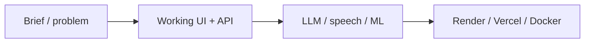

# Hi, I am Hamza Sattar

Lead AI engineer focused on **chatbots**, **voice AI**, and **practical NLP**.  
CS graduate from **GIKI**, based in **Lahore, Pakistan**.

I build prototypes that feel production-ready: bilingual assistants for fintech and retail, secure content delivery, tutoring ops tools, and research on pose estimation in crowded scenes.

## Snapshot

| | |
|---|---|
| Role | Lead AI Engineer |
| Focus | Agentic assistants, speech pipelines, clean APIs |
| Education | BS Computer Science, GIKI |
| Location | Lahore, Pakistan |
| Portfolio | [portfolio-snowy-nine-50.vercel.app](https://portfolio-snowy-nine-50.vercel.app) |
| LinkedIn | [hamza-sattar-9403b6267](https://www.linkedin.com/in/hamza-sattar-9403b6267) |
| Email | [hamzasattar9822@gmail.com](mailto:hamzasattar9822@gmail.com) |

## Featured work

### Product / demos
| Repo | One-liner | Live |
|------|-----------|------|
| [JazzCash](https://github.com/HamzaSattar9822/JazzCash) | Bilingual JazzCash-style AI assistant (LLM + RAG + voice) | [Render](https://jazzcash-ai-assistant.onrender.com) |
| [Jazz-Point](https://github.com/HamzaSattar9822/Jazz-Point) | Retailer Jazz Dost MVP (recharge, bundles, postpaid) | local MVP |
| [Content-Delivery-System](https://github.com/HamzaSattar9822/Content-Delivery-System) | Secure Drive-backed delivery links, analytics, RBAC | [Vercel](https://content-delivery-system-frontend.vercel.app) |
| [Polygon-Pedagogs](https://github.com/HamzaSattar9822/Polygon-Pedagogs) | Tutoring site with admin inbox and attendance | [Render](https://polygon-pedagogs.onrender.com) |
| [Taste-and-Tales](https://github.com/HamzaSattar9822/Taste-and-Tales) | Static food brand dashboard | [Vercel](https://taste-and-tales-swart.vercel.app) |

### Research / learning
| Repo | One-liner |
|------|-----------|
| [OAPR (full)](https://github.com/HamzaSattar9822/OAPR-Occlusion-Aware-Probabilistic-Reconstruction) | Occlusion-aware probabilistic multi-person pose reconstruction |
| [FundRaiser](https://github.com/HamzaSattar9822/FundRaiser) | Crowdfunding DApp (Solidity + React) |
| [LAB_Project](https://github.com/HamzaSattar9822/LAB_Project) | Arithmetic expression tokenizer / validator lab |
| [portfolio](https://github.com/HamzaSattar9822/portfolio) | Personal site |

## How I usually ship

## Skills I use a lot

`Python` `FastAPI` `React` `TypeScript` `Node.js` `PostgreSQL` `Prisma` `Docker` `Whisper` `LLM APIs` `RAG` `Solidity` `PyTorch`

## Open to

- Agentic assistants for fintech and retail
- Voice in / voice out products that stay reliable under load
- Clean APIs and architecture that other engineers can read quickly

If something here is useful for a collaboration, open an issue on the relevant repo or email me.
