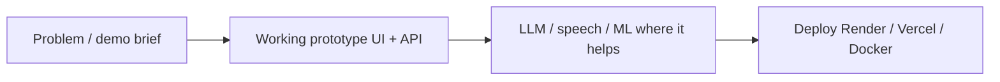

# Hi, I am Hamza Sattar

Lead AI engineer focused on chatbots, voice systems, and practical NLP. CS graduate from GIKI, based in Lahore.

I like shipping prototypes that feel real: bilingual assistants, secure content delivery, tutoring ops tools, and research on crowded-scene pose estimation.

## Find me

- Portfolio: https://portfolio-snowy-nine-50.vercel.app
- LinkedIn: https://www.linkedin.com/in/hamza-sattar-9403b6267
- Email: hamzasattar9822@gmail.com
- GitHub: https://github.com/HamzaSattar9822

## Selected projects

| Project | What it is |
|---------|------------|
| [JazzCash](https://github.com/HamzaSattar9822/JazzCash) | Bilingual JazzCash-style AI assistant (LLM + RAG + voice) |
| [Jazz-Point](https://github.com/HamzaSattar9822/Jazz-Point) | Retailer Jazz Dost MVP (recharge, bundles, postpaid) |
| [Content-Delivery-System](https://github.com/HamzaSattar9822/Content-Delivery-System) | Secure Drive-backed content links, analytics, RBAC |
| [Polygon-Pedagogs](https://github.com/HamzaSattar9822/Polygon-Pedagogs) | Tutoring site with admin inbox and attendance |
| [OAPR](https://github.com/HamzaSattar9822/OAPR-Occlusion-Aware-Probabilistic-Reconstruction) | Occlusion-aware probabilistic pose reconstruction |
| [Taste-and-Tales](https://github.com/HamzaSattar9822/Taste-and-Tales) | Static food brand dashboard |
| [FundRaiser](https://github.com/HamzaSattar9822/FundRaiser) | Crowdfunding DApp (Solidity + React) |
| [portfolio](https://github.com/HamzaSattar9822/portfolio) | Personal site |

## How I usually build

## Currently interested in

- Agentic assistants for fintech and retail
- Voice in / voice out UX that stays reliable
- Clean APIs and readable architecture docs

Thanks for stopping by. If something here is useful for a collaboration, open an issue on the relevant repo or email me.
